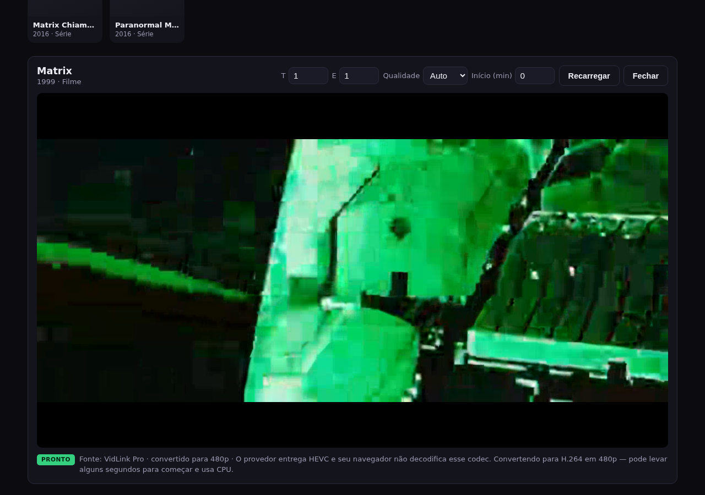

# fdsFlix

Player de filmes e séries: busca no **TMDB** e reprodução do stream via
**VidLink Pro**, sem iframes e sem pop-ups.



## Produção

| O quê | URL |
| :--- | :--- |
| App + API (Render) | <https://fdsflix.onrender.com> |
| Documentação viva | <https://fdsflix.onrender.com/api> |

O **mesmo serviço do Render** entrega a interface e a API — a Vercel é opcional.
Basta abrir <https://fdsflix.onrender.com> para usar o site.

## Como rodar

```bash
npm install
npm start
```

Abra <http://localhost:3000>.

> Requisito importante: **ffmpeg** instalado no sistema.
> ```bash
> sudo apt install ffmpeg     # Debian/Ubuntu
> sudo dnf install ffmpeg     # Fedora
> sudo pacman -S ffmpeg       # Arch
> ```
> O servidor usa o ffmpeg para converter o vídeo (o provedor entrega HEVC e a
> maioria dos navegadores no Linux/Windows não decodifica HEVC).

## O que estava quebrado (e o que foi feito)

| Problema | Causa | Correção |
| :--- | :--- | :--- |
| O vídeo nunca tocava | O CDN do provedor responde **HTTP 429** para qualquer requisição com `Referer`/`Origin` de outra origem. O navegador sempre envia esses cabeçalhos em `<video src="https://cdn...">`. | O vídeo agora passa por `/api/proxy`, que busca no CDN **sem** `Referer`/`Origin`, repassa `Range` (para buscar/avançar) e renova a URL assinada quando ela expira. |
| Tela preta mesmo com a URL certa | O provedor só entrega **HEVC** (`codecName: "hevc"`). Chrome no Linux, Firefox e Chromium não decodificam HEVC. | O servidor detecta o codec e converte para **H.264** em tempo real usando `ffmpeg`, servindo uma playlist **HLS** reproduzida pelo `hls.js` (local, em `public/vendor/`). |
| Legendas não apareciam | As legendas vêm em **SRT** (`application/x-subrip`), mas `<track>` só aceita **WebVTT**. | `/api/subtitle` baixa o SRT, converte para WebVTT e serve com `Content-Type: text/vtt`. |
| Player dependia de CDN externo | `hls.js` era carregado de `cdn.jsdelivr.net`. | `hls.js` agora é local (`public/vendor/hls.min.js`). |

Além disso, o CDN responde **HTTP 428** para `User-Agent` que comece com
`Mozilla` — o proxy usa um UA neutro. E se um navegador disser que suporta HEVC
mas reproduzir só o áudio (sem nenhum frame, `videoWidth === 0`), o player
detecta e refaz o pedido forçando a transcodificação para H.264.

## Rotas da API

| Rota | Descrição |
| :--- | :--- |
| `GET /api/popular` | Populares (TMDB, cache de 30 min) |
| `GET /api/search?q=` | Busca no TMDB |
| `GET /api/stream?id=&type=&s=&e=&res=&start=&hevc=` | Escolhe stream direto ou HLS transcodificado, legendas e sessão |
| `GET /api/proxy?t=` | Proxy do arquivo de vídeo (Range/206) |
| `GET /api/subtitle?t=&shift=` | Legenda em WebVTT (`shift` em segundos, opcional) |
| `GET /hls/:id/index.m3u8` | Playlist HLS gerada pelo ffmpeg |
| `GET /api/health` | Status do servidor, ffmpeg e sessões ativas |

O parâmetro `hevc=1` é enviado pelo navegador quando ele declara suporte a HEVC;
nesses casos o servidor entrega o arquivo original (modo `direct`) e só usa
transcodificação quando necessário.

## Variáveis de ambiente (`.env`)

| Variável | Descrição | Padrão |
| :--- | :--- | :--- |
| `PORT` | Porta do servidor Express | `3000` |
| `TMDB_API_KEY` | Chave da API do TMDB (busca/populares) | — |
| `VIDLINK_KEY_HEX` | Chave XSalsa20 usada para cifrar o token do VidLink | já configurada |
| `VIDLINK_API_URL` | Endpoint do provedor | `https://vidlink.pro/api/b` |
| `PUBLIC_BASE_URL` | URL pública usada nas respostas (URLs absolutas) | derivada do request |
| `API_KEY` | Chave opcional para proteger a API | desativada |

## Estrutura

```
server.js              Express: rotas, montagem das respostas
lib/streamExtractor.js Token cifrado + extração de qualidades e legendas
lib/proxy.js           Proxy de vídeo com Range e renovação da assinatura
lib/transcoder.js      Sessões HLS do ffmpeg (HEVC -> H.264) com limpeza automática
lib/subtitles.js       Conversão SRT -> WebVTT
lib/registry.js        Tokens opacos para proxy e legendas
public/index.html      Interface (busca, catálogo e player)
public/vendor/         hls.js local
public/config.js       URL do backend (gerado por scripts/write-config.js na Vercel)
scripts/write-config.js Gera o config.js a partir de API_BASE_URL
vercel.json            Build estático da Vercel (frontend)
Dockerfile             Backend com ffmpeg para Railway/Render/Fly.io/VPS
compose.yaml           App + healthcheck para rodar com docker compose
render.yaml            Blueprint do Render (Docker + envs + plano free)
deploy/oracle-setup.sh Setup da VM Oracle (Docker, firewall, Caddy)
docs/API.md            Documentação da API pública (usar em outros projetos)
docs/DEPLOY-ORACLE.md  Guia do Always Free (VM ARM + HTTPS grátis)
docs/DEPLOY-RENDER.md  Guia do Render + Vercel (passo a passo)
```

## Limitações

- A conversão HEVC → H.264 acontece em tempo real. Em CPUs modestas, 1080p pode
  engasgar; o teto padrão é **720p** e o modo automático usa **480p**. Para
  economizar CPU, o ffmpeg converte a partir da qualidade de origem mais baixa
  que ainda atende ao alvo (ex.: pedir 480p usa a origem 480p, não a 1080p).
- Enquanto a conversão não termina, a playlist é do tipo `EVENT`: dá para
  avançar/retroceder dentro do trecho já convertido. Ao terminar, vira VOD.
- O diretório `.tmp-hls/` guarda os segmentos temporários e é limpo
  automaticamente: ao fechar o player a sessão é encerrada, e sessões ociosas
  caem após 5 minutos.
- O campo **Início (min)** reinicia a conversão a partir do minuto informado —
  útil para conferir uma cena sem esperar o filme inteiro.

## Legendas

- **Automático:** ao usar o campo **Início (min)**, o backend desloca a legenda
  em `-start` segundos. Antes ela ficava exatamente o tempo do salto fora de
  sincronia (ex.: começar em 10 min deixava a legenda 600 s adiantada).
- **Manual:** abaixo do player há a barra **Sincronia da legenda**
  (`−0,5s` / `+0,5s` / campo livre / `0`). Valores positivos atrasam a legenda.
  O ajuste é salvo por título no `localStorage` e sobrevive a recarregar a página.
- O deslocamento é aplicado no servidor (`/api/subtitle?t=TOKEN&shift=1.5`), sem
  reiniciar o vídeo nem recarregar o stream.

## API pública (usar em outros projetos)

O backend também pode ser consumido por qualquer outro projeto. As respostas de
`/api/stream` já vêm com **URLs absolutas** (vídeo, playlist e legendas), então
basta tocar a URL devolvida.

```bash
curl "https://fdsflix.onrender.com/api/stream?id=603&type=movie&res=480&hevc=0"
```

```json
{
  "mode": "hls",
  "url": "https://fdsflix.onrender.com/hls/abc123/index.m3u8",
  "quality": 480,
  "captions": [{ "label": "Português", "srclang": "pt", "url": "https://fdsflix.onrender.com/api/subtitle?t=..." }]
}
```

Em outro projeto (navegador ou Node 18+):

```js
const res = await fetch('https://fdsflix.onrender.com/api/stream?id=603&type=movie&res=480&hevc=0');
const { mode, url, captions } = await res.json();
// mode === 'hls' -> toque com hls.js; mode === 'direct' -> <video src={url}>
```

- Documentação completa: [docs/API.md](docs/API.md)
- Documentação viva: <https://fdsflix.onrender.com/api>
- CORS liberado para qualquer origem
- `hevc=0` força H.264 (Chrome/Linux); `hevc=1` usa HEVC nativo (Safari/Windows)
- `API_KEY` (opcional): protege `/api/search`, `/api/popular` e `/api/stream`
  via header `x-api-key` ou `?key=`

## Deploy

### Modo atual: tudo no Render

O serviço `fdsflix` no Render roda o `Dockerfile` e serve **interface + API** na
mesma URL (<https://fdsflix.onrender.com>). Não é necessário criar nada na
Vercel.

Se quiser separar (UI na Vercel + API no Render), os arquivos `vercel.json` e
`scripts/write-config.js` já deixam isso pronto — veja `docs/DEPLOY-RENDER.md`.

### Por que não dá para rodar só na Vercel

O player depende de `ffmpeg` e de um **processo que gera a playlist HLS em disco
ao longo do tempo**. A Vercel roda funções serverless:

- não traz o binário do `ffmpeg`;
- o filesystem é somente leitura (só `/tmp`, efêmero e por instância);
- cada invocação é isolada — os segmentos gerados em uma não existem na outra;
- o limite de execução é de **300 s** no Hobby (800 s no Pro), e a instância
  escala a zero quando fica ociosa.

Ou seja: a Vercel serve bem o **frontend estático**, mas não o backend que
transcodifica e serve o vídeo.

### Arquitetura recomendada

```
Vercel  ──►  frontend estático (public/)
Railway / Render / Fly.io / VPS  ──►  Node + ffmpeg (este projeto inteiro)
```

#### 1. Backend (Railway, Render, Fly.io ou VPS)

O repositório já tem um `Dockerfile` com `ffmpeg` incluso e um `render.yaml`
(Blueprint) para subir no Render em poucos cliques.

- **Passo a passo do Render:** [docs/DEPLOY-RENDER.md](docs/DEPLOY-RENDER.md)
- **Passo a passo da Oracle (grátis):** [docs/DEPLOY-ORACLE.md](docs/DEPLOY-ORACLE.md)

Variáveis de ambiente do **backend**:

| Variável | Obrigatória | Descrição |
| :--- | :--- | :--- |
| `TMDB_API_KEY` | sim | chave do TMDB |
| `VIDLINK_KEY_HEX` | sim | chave XSalsa20 do VidLink |
| `VIDLINK_API_URL` | não | padrão `https://vidlink.pro/api/b` |
| `PUBLIC_BASE_URL` | não | URL pública do backend; se vazia usa `RENDER_EXTERNAL_URL` ou o request |
| `MAX_TRANSCODE_HEIGHT` | não | teto da conversão em pixels de altura (padrão `720`; use `360` no Free) |
| `MAX_SESSIONS` | não | conversões simultâneas (padrão `2`; use `1` no Free) |
| `API_KEY` | não | se definida, exige `x-api-key`/`?key=` nas rotas de entrada |
| `PORT` | não | Railway/Render injetam automaticamente |
| `NODE_ENV` | não | `production` |

> **Render Free = 0.1 CPU / 512 MB.** O cold start leva ~1 min (o app avisa na
> tela) e a conversão HEVC → H.264 **não acompanha em tempo real** nesse plano.
> Em navegadores que tocam HEVC (Safari, Windows com o codec) o modo `direct`
> não converte e o Free dá conta do proxy; no Chrome/Linux, prefira um plano com
> pelo menos 0.5–1 CPU (Render Starter/Standard, Railway, Fly.io) ou um VPS.

Teste: `https://SEU-BACKEND/api/health` deve responder
`{"ok":true,"ffmpeg":true,...}`.

O frontend mostra na tela o aviso **"Acordando o servidor…"** enquanto o Render
gratuito inicia, e um rodapé com o aviso de cold start quando `API_BASE_URL` está
configurada.

#### 2. Frontend (Vercel)

- Framework Preset: **Other**
- Build Command e Output Directory: já definidos no `vercel.json`
  (`node scripts/write-config.js` e `public`)

Variáveis de ambiente na **Vercel**:

| Variável | Obrigatória | Descrição |
| :--- | :--- | :--- |
| `API_BASE_URL` | sim | URL pública do backend (ex.: `https://fdsflix-api.up.railway.app`), sem barra no final |
| `API_KEY` | não | só se você ativou `API_KEY` no backend; fica visível no bundle (proteção leve) |

O `vercel.json` executa `scripts/write-config.js` no build, que gera
`public/config.js` com essa URL. As chaves (TMDB/VidLink) ficam **só no
backend** — a Vercel não precisa delas.

Se preferir não usar a variável, edite `public/config.js` à mão e remova o
`buildCommand` do `vercel.json`.

O backend libera CORS para qualquer origem, então o domínio da Vercel funciona
sem configuração extra.

> Se a sua intenção é subir tudo em um host só, use **Railway** ou **Render**
> (com o `Dockerfile`) e ignore a parte da Vercel — é bem mais simples.

#### Alternativa gratuita: Oracle Cloud Always Free

A Oracle dá uma VM ARM **2 OCPUs / 12 GB** (1.500 OCPU-horas + 9.000 GB-horas por
mês), com **10 TB/mês de saída** — de graça. É a opção mais forte para rodar o
`ffmpeg` sem pagar nada.

- Guia completo: [docs/DEPLOY-ORACLE.md](docs/DEPLOY-ORACLE.md)
- Setup automatizado da VM: `deploy/oracle-setup.sh`
- `compose.yaml` já pronto (app + healthcheck)
- HTTPS grátis com **Caddy + DuckDNS**

> Atenção: em 2026 a Oracle reduziu o Always Free de 4/24 para **2 OCPUs / 12 GB**.
> E ela pode recolher VMs ociosas; o guia explica como evitar (upgrade para
> Pay As You Go mantendo o Always Free em US$ 0).

| Onde | Envs |
| :--- | :--- |
| Vercel (frontend) | `API_BASE_URL` (e `API_KEY` se usada) |
| Render/Railway/Fly/VPS (backend) | `TMDB_API_KEY`, `VIDLINK_KEY_HEX`, `VIDLINK_API_URL` · opcionais: `API_KEY`, `MAX_TRANSCODE_HEIGHT`, `MAX_SESSIONS` |

### Segurança

- O arquivo `.env` **não** deve ir para o repositório (já está no `.gitignore`).
- O `.env.example` agora usa placeholders. Se você já publicou o repositório com
  a chave real do VidLink, **troque/rotacione essa chave**.
